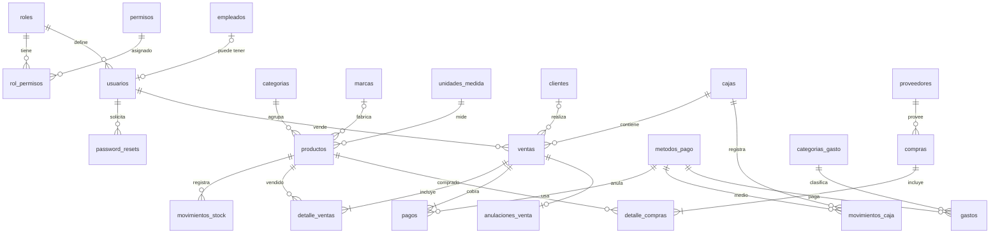

# KioscoPro — Análisis, arquitectura y diseño de base de datos

## 1. Análisis de requisitos

| Área | Decisión |
|---|---|
| Usuarios | 4 roles fijos (Dueño, Administrador, Vendedor, Cajero). Los permisos son **datos** (tabla `permisos` + `rol_permisos`), no `if rol == ...` repartidos en el código. Las rutas se protegen con `@permiso_requerido("codigo")`. |
| Primer uso | Si no existe ningún usuario, la app redirige a **Registro inicial del dueño**. Después esa pantalla queda deshabilitada. |
| POS | Pantalla única optimizada para teclado y lector de código de barras (el lector "tipea" el código + Enter). Los precios **siempre se recalculan en el servidor**: el navegador solo envía `producto_id`, `cantidad` y descuentos. |
| Transacciones | Venta, compra, anulación y cierre de caja se ejecutan en **una sola transacción**. El stock se bloquea con `SELECT ... FOR UPDATE` (MySQL) para evitar ventas simultáneas del último producto. |
| Caja | Hay **una caja abierta a la vez** (un mostrador). Toda venta queda asociada a la caja abierta. Sin caja abierta no se puede vender (regla configurable con `REQUIERE_CAJA_ABIERTA`). |
| Anulaciones | Nunca se borra una venta. Cambia su estado a `anulada` o `devuelta`, se guarda quién/cuándo/por qué en `anulaciones_venta`, se reintegra el stock (opcional en devoluciones) y se registra un egreso en la caja abierta. |
| Listados | Productos, ventas, compras, clientes y proveedores **no** se listan completos: primero se muestran filtros y recién al buscar aparecen resultados paginados. |
| Ganancia | `Ganancia bruta = Ventas netas − Costo de lo vendido` (el costo se toma del **precio de compra congelado en cada línea de venta**, no del precio actual). `Ganancia neta = Ganancia bruta − Gastos`. |
| Seguridad | Hash scrypt (Werkzeug), sesiones firmadas con cookie `HttpOnly` + `SameSite=Lax`, CSRF en todos los formularios y peticiones `fetch`, ORM con parámetros enlazados, autoescape de Jinja + CSP sin scripts inline, límite de intentos de login, `.env` para secretos. |
| Móvil | Sidebar tipo "off-canvas", tablas con scroll horizontal, POS apilado con barra de total fija abajo. |

## 2. Arquitectura

Arquitectura **en capas** (variación de MVC adaptada a Flask):

```
Navegador ──HTTP──> routes/  (Controladores: validan entrada, permisos y eligen template)
                       │
                       ▼
                   services/ (Reglas de negocio y transacciones: venta, compra, caja, stock…)
                       │
                       ▼
                   models/   (Entidades SQLAlchemy = tablas MySQL)
                       │
                       ▼
                    MySQL
templates/ (Vistas Jinja2)   static/ (CSS, JS, Chart.js local)   utils/ (decoradores, validación, helpers)
```

**Por qué una capa `services/`**: una venta toca 6 tablas (ventas, detalle, pagos, stock, movimientos de stock y de caja). Si esa lógica viviera en la ruta, no se podría reutilizar (por ejemplo desde un comando o una API futura) ni testear aislada. Las rutas quedan finas y los servicios concentran las reglas.

**Por qué SQLAlchemy (ORM) y no SQL a mano**: todas las consultas usan parámetros enlazados automáticamente (protección contra SQL Injection sin depender de la disciplina de cada consulta) y el mismo código funciona en MySQL (producción) y en SQLite (modo demo para probar sin instalar nada). El archivo `database/schema.sql` es el script oficial para MySQL y es equivalente a los modelos.

**Chart.js** se sirve localmente (`static/js/vendor/`) para que el sistema funcione aunque se caiga internet en el local. **No se usa Bootstrap**: el CSS propio es más liviano y da una identidad visual propia.

## 3. Modelo de datos (3FN)



### Relaciones principales
- **roles 1:N usuarios** y **roles N:M permisos** (tabla puente `rol_permisos`).
- **empleados 1:0..1 usuarios**: `usuarios.empleado_id` es `UNIQUE` y opcional (el dueño o un usuario técnico pueden no ser empleados; un empleado de reposición puede no tener usuario).
- **productos N:1 categorías / marcas / unidades_medida**. Categorías, marcas y unidades son tablas propias para no repetir texto (3FN).
- **ventas 1:N detalle_ventas**, **ventas 1:N pagos** (el modelo soporta pago mixto aunque el POS use un medio por venta), **ventas 1:0..1 anulaciones_venta**.
- **compras 1:N detalle_compras**, **proveedores 1:N compras**.
- **cajas 1:N movimientos_caja** y **cajas 1:N ventas**.
- **movimientos_stock** referencia opcionalmente a la venta o compra que lo originó (trazabilidad completa).

### Desnormalizaciones deliberadas (justificadas)
| Campo | Motivo |
|---|---|
| `productos.stock_actual` | Es derivable de `movimientos_stock`, pero recalcularlo en cada búsqueda del POS sería lento. Se actualiza siempre dentro de la misma transacción que el movimiento (que guarda `stock_anterior`/`stock_nuevo`, por lo que se puede auditar). |
| `detalle_ventas.precio_unitario` y `costo_unitario` | **No es duplicación**: es el precio *histórico* al momento de la venta. Si mañana cambia el precio, la venta de ayer no debe cambiar. |
| `ventas.subtotal/descuento/total`, `compras.total` | Totales históricos congelados; evitan re-sumar detalles en cada reporte. Se calculan en el servidor. |
| `cajas.monto_esperado/diferencia` | Foto del arqueo al cerrar, para consulta posterior aunque se corrijan datos. |

## 4. Estructura de carpetas

```
drugstore/
├── run.py                  # Punto de entrada (desarrollo y WSGI)
├── wsgi.py                 # Para gunicorn / waitress en producción
├── requirements.txt
├── .env.example
├── INICIAR.bat             # Arranque en 1 clic (Windows, modo demo)
├── README.md
├── tests/                  # Pruebas automatizadas (pytest)
├── database/
│   └── schema.sql          # Script MySQL completo + datos base (roles, permisos, medios de pago)
├── docs/ARQUITECTURA.md
└── app/
    ├── __init__.py         # App factory, blueprints, cabeceras de seguridad, errores
    ├── config.py           # Configuración por entorno (lee .env)
    ├── extensions.py       # db, login_manager, csrf
    ├── cli.py              # flask init-db / seed-demo / crear-dueno
    ├── models/             # Entidades por dominio: seguridad, personas, catalogo, ventas, operaciones
    ├── services/           # Reglas de negocio y transacciones (venta, compra, caja, stock, reportes…)
    ├── routes/             # Blueprints (controladores): auth, dashboard, ventas, productos, stock…
    ├── utils/              # decoradores, helpers de formato/validación, mail, rate-limit, imágenes
    ├── templates/          # base.html + 1 carpeta por módulo (+ usuarios/, errors/, partials/)
    └── static/ css/ js/ img/ uploads/
```

Diferencias con la estructura sugerida y motivo:
- `templates/usuarios/`, `templates/errors/` y `templates/partials/` (macros reutilizables: paginación, íconos, campos) para no repetir HTML.
- `database/` separado de `app/` porque el SQL es para el DBA/instalación, no código de la app.
- `wsgi.py` para desplegar con un servidor de producción sin tocar `run.py`.
